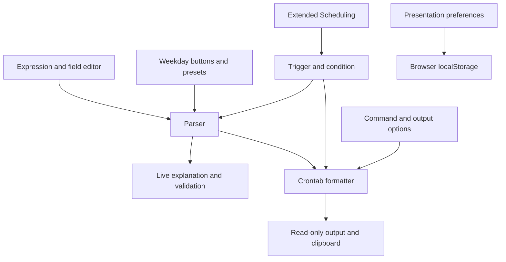

# 🧱 CronCompose Architecture

**Status:** Implemented local release candidate `0.1.0-alpha.2`; not deployed.

## Scope and classification

SFW v1.1.0 Profile B (browser-only interactive tool), plus D controls for deployment automation. Highest change tier T2: public untrusted cron input parser and material deployment configuration. Owner release approval required. No backend or execution service.

---

## Components

| Module | Responsibility |
| --- | --- |
| `public/index.html` | Semantic workspace and reference |
| `public/assets/css/style.css` | Responsive presentation, fixed weekday geometry, themes |
| `public/assets/js/cron.js` | Bounded parser, weekday selection, description |
| `public/assets/js/extended.js` | Monthly trigger/condition generation and compatibility |
| `public/assets/js/format.js` | User/system line formatting, validation, comments, redirection |
| `public/assets/js/preferences.js` | Allowlisted local presentation storage |
| `public/assets/js/app.js` | Event handling, UI state, safe text output and copy |

---

## Data flow and layout

The right-aligned weekday selector sits beneath the Weekday field. Its summary and seven buttons occupy independent grid rows; selection text cannot reflow the buttons. A container-width query places the schedule explanation to the left when the editor content is at least 580px wide. On narrower editors the selector and explanation stack, with the selector aligned right. When the weekday selector is hidden (extended or startup schedules), the explanation occupies the full available width. Extended mode hides the normal weekday field and buttons, locks date fields and the raw expression, and retains editable minute/hour. Removal restores the pre-extension schedule; regular presets explicitly clear the condition. Collapsing the section does not remove it.

---

## Extended scheduling

The generated cron trigger selects one weekday (or all days for month end). A shell condition obtains a single local date snapshot. Ordinal occurrences check the day of month against a seven-day interval; last occurrences compare the current ISO date with the month reached in seven days (or one for month end). Look-ahead uses UTC calendar arithmetic, not elapsed hours across DST. A shell `case` avoids unescaped percent parameter expansion. The command is single-quoted for a child `/bin/sh -c` invocation; output suppression applies to that command, not failed guard checks.

No shell is executed in the browser. The operator must review the resulting entry and environment before installing it. Cron daemon behaviour is not independently tested in this candidate.

---

## Deployment boundary

Only `public/` is published. A single workflow gates packaging on quality, shell integration tests, secret scanning and CodeQL results. Packaging checks out the exact tested SHA; the deploy job receives Pages/OIDC privileges. Production uses the `github-pages` environment. No user data leaves the browser via application logic; CSP prohibits connections and inline scripts.
